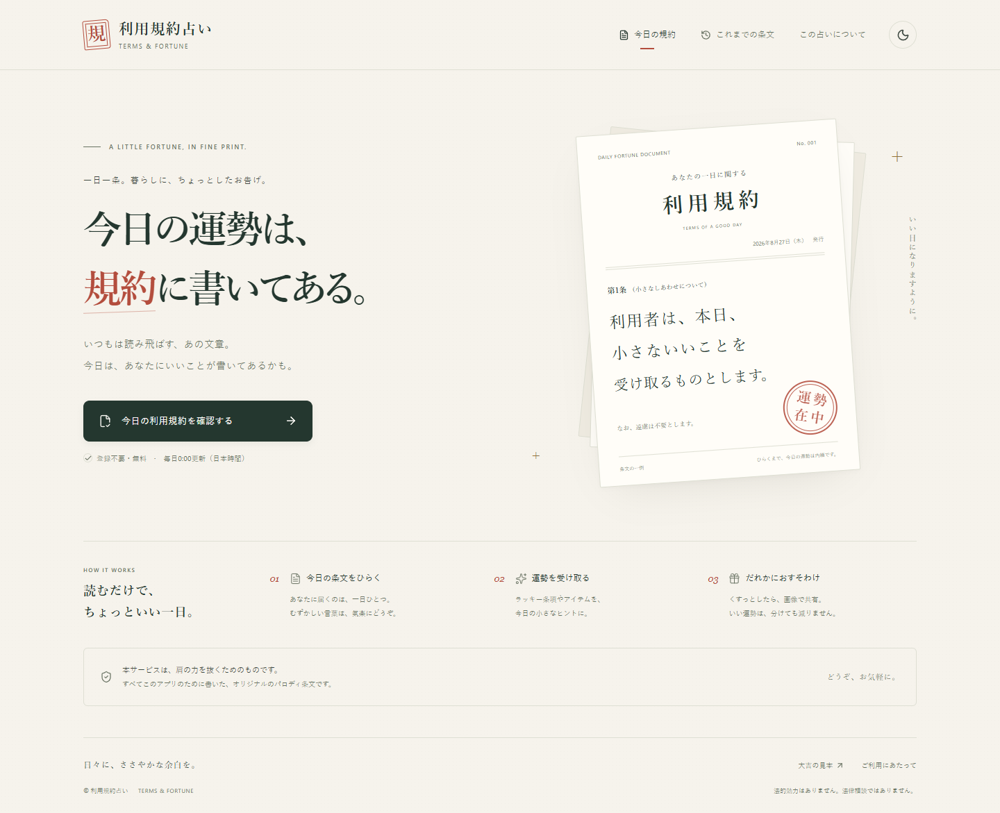
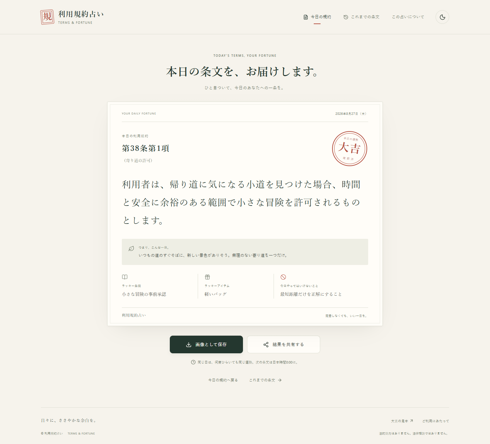
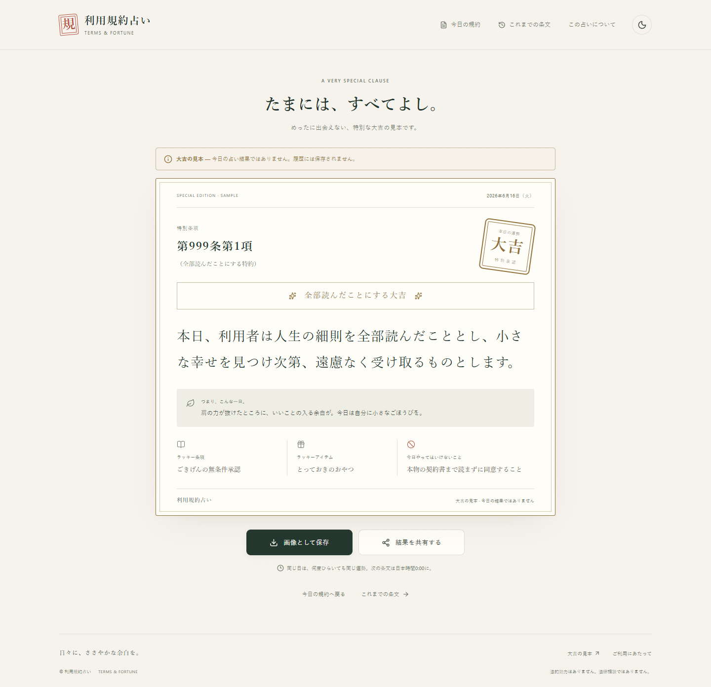
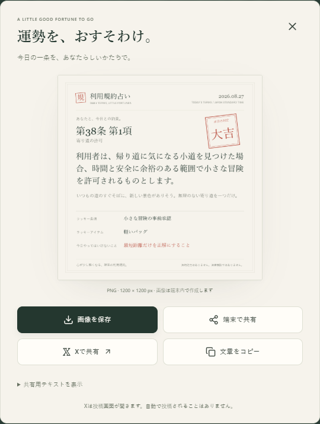
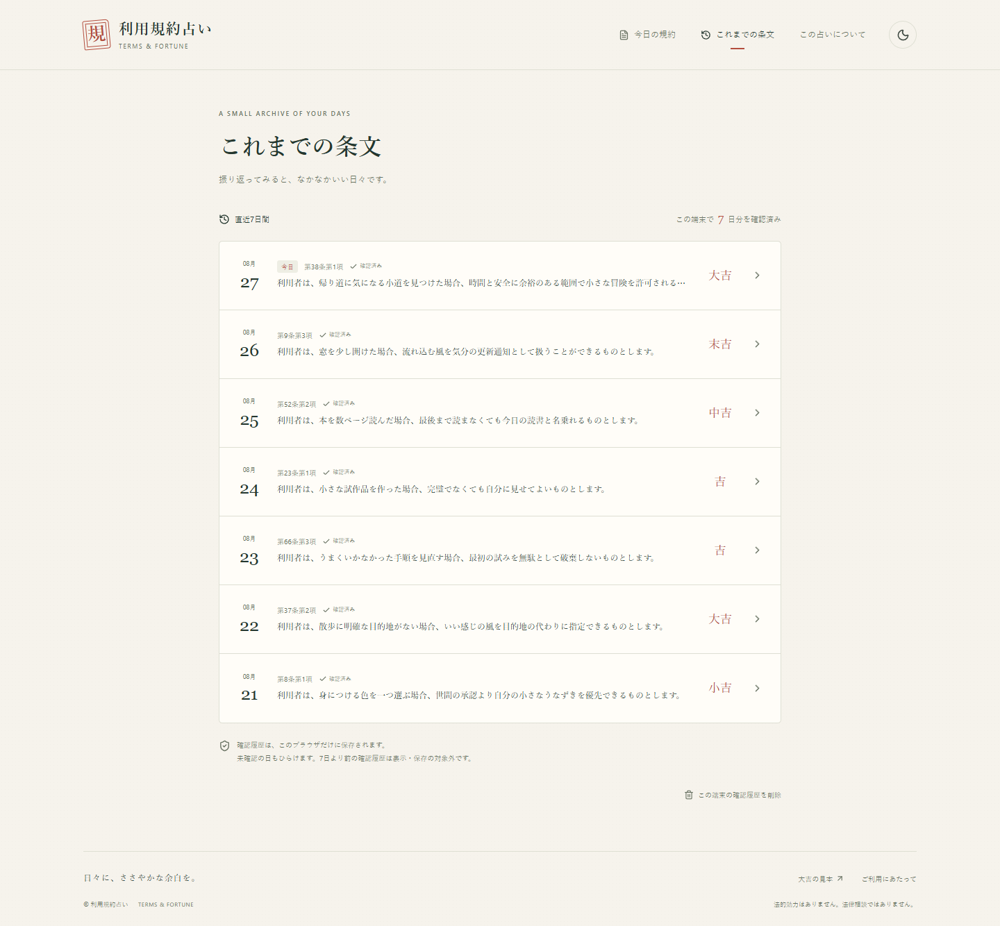

# 利用規約占い

> 今日の運勢は、規約に書いてある。

ふだんなら読み飛ばす利用規約を、今日は自分のために。
架空の条文を一日ひとつ受け取る、小さな日替わり占いWebアプリです。
紙の余白、朱色の印影、少しおかしな契約文で、毎日にひと息つくきっかけを届けます。

[公開アプリを開く](https://terms-fortune.vercel.app) · [GitHubでソースを見る](https://github.com/shunsoco-stack/terms-fortune)

表示する条文は、すべて本アプリ専用に書き下ろしたパロディです。実在するサービスの利用規約を転載していません。**法的効力はありません。法律相談ではありません。** 娯楽としてお楽しみください。

## できること

- 「今日の利用規約を確認する」から、その日の条文を開く。
- 今日の条文・運勢ランク・ラッキー条項・ラッキーアイテム・今日やってはいけないことを読む。
- 72件の通常条文と、レアな「全部読んだことにする大吉」に出会う。
- 直近7日間の実際の日替わり結果を振り返る。確認済みの日には閲覧マークがつく。
- Canvasで生成した1,200 × 1,200pxの共有カードをプレビューし、PNG画像として保存する。
- X、Web Share API、クリップボードで共有する。共有URLには結果の日付を含める。
- ライト／ダークモードを切り替え、対応ブラウザからホーム画面に追加する。

登録・ログイン・占い用の外部APIは不要です。初回オンラインでオフライン準備が完了すれば、占い・履歴・画像作成をオフラインでも利用できます。Xへの投稿や共有先への送信には通信が必要です。

## 日替わりのしくみ

日本時間（Asia/Tokyo）の午前0時を日付の境界にしています。同じ日付には、再読み込みしても、別の端末から見ても同じ結果を表示します。翌日は別の条文になります。

通常条文は日付から決定的に選び、同じ条文が連日続かないようにしています。レア条文は97日に一度の特別な日だけに登場します。実際の未来を予測するものでも、確率抽選をするものでもありません。

日付付き共有URLの形式は /?date=YYYY-MM-DD#result です。受け取った人にもその日付の結果を表示し、今日の結果へ黙って置き換えません。

「大吉の見本」は実際のレア日を使った、明示的なサンプル画面です。今日の抽選結果とは区別し、閲覧履歴や通常の操作イベントには加えません。

## スクリーンショット

[公開アプリ](https://terms-fortune.vercel.app) を新しいChromeプロファイルで開いて撮影した5枚です。各画像の撮影元URL・時刻・ブラウザは [撮影記録](public/screenshots/capture-info.json)、検証範囲は [docs/verification.md](docs/verification.md) を参照してください。

### 1. トップ画面

### 2. 占い結果

### 3. 大吉結果

「全部読んだことにする大吉」の**見本画面**です。撮影日の今日の結果ではありません。

### 4. 共有カード

### 5. 履歴画面

### 公開画面の撮影を再現する

認証なしで表示できる公開アプリのHTTPS URLを指定します。

~~~bash
npm run screenshots -- https://terms-fortune.vercel.app
~~~

[撮影スクリプト](scripts/capture-screenshots.mjs) は新しいブラウザプロファイルで公開UIを操作し、上記5枚を public/screenshots/ に保存します。大吉は明示的な見本画面、履歴は直近7日分を実際に開いた状態で撮影します。既存の同名画像は更新されます。

同時に生成する [capture-info.json](public/screenshots/capture-info.json) は撮影元の記録です。公開元URL、ビューポート、ブラウザ、各画像のファイル名・撮影時のURL・撮影時刻、見本と履歴の扱いを残します。5枚のPNGとこのJSONを一緒に管理します。

## 実装

Next.js 16.3.3（App Router）／React 19／TypeScript／Tailwind CSS 4。アプリの状態と履歴はブラウザで管理し、データベースは使いません。

| 役割 | ファイル |
| --- | --- |
| オリジナル条文72件＋レア1件 | [src/data/clauses.ts](src/data/clauses.ts) |
| 日本時間・日付検証・日替わり結果 | [src/lib/fortune.ts](src/lib/fortune.ts) |
| 直近7日間の閲覧記録 | [src/lib/history.ts](src/lib/history.ts) |
| テーマ・時刻更新・画面状態 | [src/lib/client-state.ts](src/lib/client-state.ts) |
| Canvas共有カード | [src/lib/share-card.ts](src/lib/share-card.ts) |
| 操作イベント計測 | [src/lib/analytics.ts](src/lib/analytics.ts) |
| PWA manifest／Service Worker | [src/app/manifest.ts](src/app/manifest.ts) ／ [public/sw.js](public/sw.js) |
| Secret Scan | [scripts/secret-scan.mjs](scripts/secret-scan.mjs) |
| 掲載用文章 | [docs/publish-copy.md](docs/publish-copy.md) |

条文を変更すると、その日付の結果も変わります。v1の並び順・IDは固定し、結果の再現性を保っています。

## ローカルで動かす

Node.js 24.xを使用します（package.jsonのenginesで固定）。APIキーや環境変数の設定は不要です。

~~~bash
git clone https://github.com/shunsoco-stack/terms-fortune.git
cd terms-fortune
npm ci
npm run dev
~~~

ブラウザで http://127.0.0.1:3000 を開きます。

~~~bash
npm run lint
npm run typecheck
npm test
npm run secret-scan
npm run build
~~~

まとめて実行する場合は npm run verify を使います。typecheckはNext.jsの型生成も実行します。lintはbuildとは別に実行します。verifyにはE2Eテストを含めていません。

本番相当の確認は npm run build の後、npm run start で行います。PWAのService Workerは本番モードで確認してください。開発時の古いキャッシュの影響を避けるには、ブラウザの開発者ツールからこのアプリのService Workerとサイトデータを削除します。

### E2Eテスト

まず1つ目のターミナルで本番ビルドを作り、ポート3174でサーバーを起動します。

~~~bash
npm run build
npm run start -- --port 3174
~~~

起動したまま、別のターミナルで実行します。

~~~bash
npm run test:e2e
~~~

[Playwright設定](playwright.config.ts) は http://127.0.0.1:3174 を対象に、デスクトップ幅とモバイル幅の両方を検証します。テスト側からサーバーは起動しないため、next devへ自動的に切り替わることはありません。

既定のブラウザは端末にインストール済みのGoogle Chromeです。PlaywrightのChromiumを使う場合は、ブラウザを用意し、E2E_BROWSER_CHANNELをchromiumに設定します。PowerShellの例：

~~~powershell
npx playwright install chromium
$env:E2E_BROWSER_CHANNEL = 'chromium'
npm run test:e2e
~~~

Bashでは E2E_BROWSER_CHANNEL=chromium npm run test:e2e と指定できます。撮影コマンドも同じブラウザ指定を参照します。公開先をE2E検証する場合は、E2E_BASE_URLに確認済み公開URLを設定します。

失敗時のスクリーンショット・トレースは test-results/、HTMLレポートは playwright-report/ に出力します。最新の実行結果と公開環境での確認は [検証記録](docs/verification.md) を参照してください。

## 保存データと計測

localStorageには閲覧した日付とテーマ設定を保存します。条文本文や個人情報を履歴に保存する設計ではありません。履歴画面は今日を含む7暦日分だけを表示し、対象期間外の閲覧記録は次の記録保存時に整理します。見本は保存しません。

ブラウザの保存が制限されている場合も、占い自体は利用できます。履歴・設定は端末やブラウザをまたいで同期されません。

Vercel Analyticsへ次の操作イベントを渡す計測コードを実装しています。ローカルの本番ビルドで、実操作からSDKへの呼び出し・見本の除外・計測障害時の継続を確認しています。E2Eでは計測通信を遮断しており、Vercel側の受信・集計を確認したものではありません。履歴一覧は送信しません。

| イベント | 対象 |
| --- | --- |
| fortune_draw | 占いの実行 |
| image_save | 共有カード画像の保存操作 |
| share | X・Web Share・クリップボードによる共有操作 |

**計測上の制限：現在のデプロイ先はHobbyプランです。カスタムイベントの集計・ダッシュボード表示はPro／Enterprise限定のため、占い実行・画像保存・共有の本番集計は未対応です。** 実装済みの計測コードだけで、この要件を達成したとは扱いません。プラン変更や有料トライアル開始は行っていません。[Vercel公式のプラン別対応表](https://vercel.com/docs/analytics/limits-and-pricing)

ページビューのWeb AnalyticsはHobbyの無料上限内で利用でき、設定の有効化と公開環境でのSDKスクリプト読込みは確認済みです。ただし今回の自動テスト用ブラウザはSDKの計測対象から除外されるため、ページビューの本番受信・集計は確認していません。[公式セットアップ手順](https://vercel.com/docs/analytics/quickstart) と [検証記録](docs/verification.md) を参照してください。計測できない場合も占い機能は止めません。

## CI・公開

[GitHub Actions](.github/workflows/ci.yml) で、mainへのpushとPull Request時に依存関係の固定インストール・lint・型検査・単体テスト・Secret Scan・本番ビルドを実行します。権限はcontentsの読み取りだけで、デプロイ用トークンを保持しない検証専用ワークフローです。

ローカルでlint・typecheck・単体テスト78件・E2E58件・本番ビルドが成功し、[GitHubの品質CI](https://github.com/shunsoco-stack/terms-fortune/actions/runs/33062013483) も通過しています。ローカルE2Eと公開先での確認は [検証記録](docs/verification.md) に分けています。

公開先では主要画面、1,200pxの共有画像生成、390px幅の表示、ダークモード、PWA関連ファイルとService Workerの制御を確認しています。公開ページの未捕捉ブラウザエラーは0件でした。SNSへの実投稿は行っていません。

Vercelへの公開は認証済みCLIで行っています。GitHubからVercelへの自動デプロイは未接続のため、GitHubへのpushだけでは公開されません。再公開はリポジトリ直下から次の手順で行います。

~~~bash
npx vercel@59.7.0 login
npx vercel@59.7.0 link
npm run verify
npx vercel@59.7.0 deploy --prod
~~~

loginとlinkは初回のみ必要です。linkでは自分のVercelチームと対象プロジェクトを選択します。フレームワークはNext.js、ルートディレクトリはリポジトリ直下、ビルドコマンドは npm run build です。

Secret Scanはリポジトリ内のテキストをローカルで検査し、秘密鍵・既知のトークン形式・認証情報らしい代入・認証情報入りURLを検出します。検出時は値を表示せず、ファイル・行番号・ルール名だけを報告して失敗します。依存関係、ビルド成果物、バイナリ、ログ、シンボリックリンク、スキャナー自身のルール定義は対象外です。Git履歴の検査や完全な安全性を保証する監査ではありません。

これとは別に、Gitleaks 8.30.1で初回公開時の全Git履歴を検査し、検出0件でした。GitHub Secret ScanningとPush Protectionも有効で、確認時点の未解決アラートは0件です。

## ライセンス

[MIT License](LICENSE)
